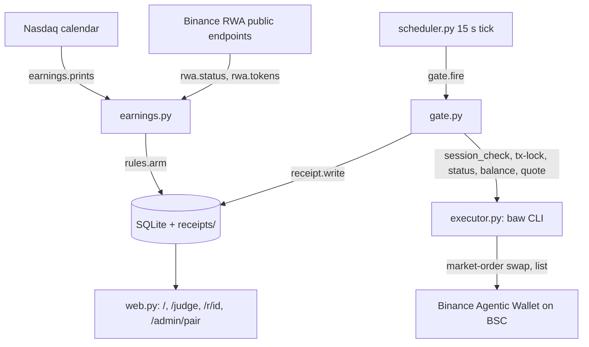

<div align="center">

# Warden


[](https://github.com/Yonkoo11/warden/actions/workflows/tests.yml)

[](https://warden-production-e5c3.up.railway.app)

### Earnings rules for tokenized stocks, executed through Binance Agentic Wallet, with a receipt for every run.

**A holder of a tokenized US stock on BNB Chain writes one rule around an earnings report ("sell 50% of APLDon 60 minutes before the print"). Before the print, Warden checks the issuer's live trading status, the wallet session and lock, the balance, the quote and the daily quota, then places a market order from the agent wallet paired in the Binance app. The live test on 5 Oct 2026 bought 5 USDT of APLDon and sold half back: 3 of 3 orders FINISHED on BSC mainnet, round trip 0.76% plus 0.00003 BNB of gas.**

**[ Live ↗ ](https://warden-production-e5c3.up.railway.app)** · **[ For judges ↗ ](https://warden-production-e5c3.up.railway.app/judge)** · **[ Verify it yourself ↗ ](#verify-it-yourself-in-60-seconds)** · **[ The receipt ↗ ](https://bscscan.com/tx/0x6ac479545c300e5fbb58d46408b0f99af46b9b71804b9f5eb33e90f170007eb4)** · **[ Demo clip, 36 s ↗ ](https://github.com/Yonkoo11/warden/raw/main/docs/demo/warden-demo.mp4)**

Built for BNB Hack: Tokenized Stocks Edition (main track, Binance Web3 Wallet).

</div>

---

## Table of contents
- [The problem](#the-problem)
- [What Warden is](#what-warden-is)
- [Verify it yourself in 60 seconds](#verify-it-yourself-in-60-seconds)
- [The headline result](#the-headline-result)
- [Architecture](#architecture)
- [The gate](#the-gate)
- [What's real, and what we deliberately did not claim](#whats-real-and-what-we-deliberately-did-not-claim)
- [Tech stack](#tech-stack)
- [Project layout](#project-layout)
- [Run it locally](#run-it-locally)
- [Tests](#tests)

## The problem
- **Earnings prints land outside the holder's day.** Most US prints are pre-market or after hours. Binance reported that 62% of bStocks volume in July 2026 traded while US markets were closed, so the token moves while the holder is asleep or at work.
- **Issuers change the rules around a print.** Binance's per-asset status can flip to `ASSET_LIMITED` with reason `earnings`. A bot that does not read that status sends an order that fails, or worse, fills at a bad price.
- **An agent that trades for you needs a paper trail.** The Agentic Wallet market order has no preview step, so the only pre-trade evidence is the quote. Warden writes it down, with the session, lock, status, balance and quota checks, before it signs anything.

## What Warden is
One rule per holding, written by the holder, run once, with a receipt. The loop:

<div align="center">

**`PRINT → GATE → QUOTE → ORDER → RECEIPT`**

</div>

1. **Print.** The Nasdaq earnings calendar is joined to Binance's RWA token list, so the holder sees which of their BSC tokens report in the next 14 days and in which session. Rows with no confirmed hour cannot be armed (`warden/earnings.py`, `warden/rwa.py`).
2. **Gate.** At T-24h and T-1h the scheduler checks the wallet session. At fire time it checks the session again, the wallet lock, the issuer's status, the balance, and the daily quota (`warden/gate.py`, `warden/scheduler.py`).
3. **Quote.** `baw market-order quote` for the exact amount. The quote is refused if it deviates more than 1.5% from the per-share price Binance publishes, or if it is under the venue's minimum (`warden.toml`).
4. **Order.** `baw market-order swap`, then `market-order list` polled every 3 s until FINISHED or FAILED (`warden/executor.py`).
5. **Receipt.** Canonical JSON with every check, the quote, the order id, the terminal status, the BscScan hash and a sha256, written to disk and SQLite, rendered at `/r/<id>`. Refusals and waits get the same receipt (`warden/receipt.py`).

## Verify it yourself in 60 seconds
No API key, no wallet, no funds. The public Binance RWA endpoints and the Nasdaq calendar need no key. Every expected output below was produced by a run on 2026-10-11 before it was written here.

```bash
git clone https://github.com/Yonkoo11/warden.git && cd warden
python3 -m venv .venv && .venv/bin/pip install -r requirements.txt

.venv/bin/python -m pytest -q                              # → 29 passed
.venv/bin/python -m warden.cli status --token APLDon      # → {"symbol": "APLDon", "reasonCode": "MARKET_CLOSED", "reasonMsg": "Weekend or Holiday", "per_share": "23.583103", "stock_price": "23.583103", "session_ok": false, ...}
.venv/bin/python -m warden.cli prints --days 7            # → one JSON line per print, e.g. {"ticker": "JPM", "date": "2026-10-13", "time": "pre-market", "confirmed": true, "tokens": ["JPMon", "JPMx", "JPMB"]}
```

This proves the data path and the gate logic (the tests run the gate and scheduler against a fake executor and a fake clock, no network). It does not prove execution: that needs a paired Binance Agentic Wallet, and the evidence for that is the three transactions in the next section.

## The headline result
The live test, 2026-10-05 03:36 UTC, from the Agentic Wallet `0x554c…BAA5`, all three through `baw market-order swap` and polled to FINISHED:

| Order | Amount | BscScan |
|---|---|---|
| BNB to USDT | 0.0076 BNB | [0x49ba5e6a…f56985](https://bscscan.com/tx/0x49ba5e6a19af7544eb45bdb8f32b46e67af51cb101173b96eed1dd31ebf56985) |
| Buy APLDon (Applied Digital, Ondo) | 5 USDT | [0xb16358f5…b330b6](https://bscscan.com/tx/0xb16358f5bc6d2ea9e19289d018e04847b5498ad29d0803b95c588496f2b330b6) |
| Sell half | 0.096416 APLDon | [0x6ac47954…07eb4](https://bscscan.com/tx/0x6ac479545c300e5fbb58d46408b0f99af46b9b71804b9f5eb33e90f170007eb4) |

Buy filled 0.27% above mid, sell 0.49% below mid: a 0.76% round trip on 5 USDT. The raw wallet responses are in `probe/swaps.jsonl`. The sell is the receipt shown on the home page of the live instance.

## Architecture

`gate.py` holds the refusal rules, `executor.py` is the only file that talks to the wallet CLI, `web.py` never reaches the wallet directly.

## The gate
Every check is recorded on the receipt whether it passed or not.

| Check | Source | Refuses when |
|---|---|---|
| Wallet session | `baw wallet status`, `wallet settings` | UNCONNECTED, or fewer than 2 minutes left before `sessionExpireTime` (sessions last 48 h) |
| Trading lock | `baw wallet tx-lock` | lock on |
| Issuer status | Binance per-asset status | `ASSET_LIMITED`, `ASSET_PAUSED`; `MARKET_CLOSED` waits and records the next open time |
| Balance | `baw wallet balance` | held quantity below the rule's sell share |
| Quote | `baw market-order quote` | deviation from the published per-share price over 1.5%, or value under the venue minimum (about 4.75 USD to buy, 1 USD to sell on Ondo tokens, measured) |
| Quota | `baw wallet settings` daily limit | notional over `quotaLeft` or over 50 USD |

## What's real, and what we deliberately did not claim
| Capability | Status |
|---|---|
| **Execution through Binance Agentic Wallet** | Real. Three market orders FINISHED on BSC mainnet on 2026-10-05, hashes above. |
| **Issuer status, token list, per-share price, dynamic data** | Real. Read live from Binance's public RWA endpoints on every page load and every tick. |
| **Gate, scheduler, receipts** | Built and tested: 29 tests on a fake executor and fake clock, including an end-to-end rule run that ends "executed" with a receipt. |
| **Hosted instance** | Live on Railway with the scheduler running. Its wallet session is paired by the owner from the Binance app and expires after 48 h; when it is not paired, every scheduled rule ends as a "waited: session expired" receipt. |
| Slippage | Measured, not asserted: +0.27% buy, −0.49% sell on 5 USDT of APLDon. |
| A scheduled rule firing live | Not yet. The 7 Oct APLDon rule missed because the wallet session had expired before the T-1h check. The live proof is the manual test above. |
| Transaction API simulation | Not used. Agentic Wallet market orders have no preview or dry-run step; the quote is the only pre-trade evidence. |
| Limit orders | Not used. Another entrant reported "Raw limit orders are not supported" on bStocks (2026-09-29). |
| K-line history | The public K-line endpoint rejected every time range tried (code 000002); only the latest candles are read. |
| Earnings hour | From the Nasdaq calendar. "time-not-supplied" rows stay disarmed; Binance publishes no earnings calendar. |
| BNB Agent Studio, Wallet Skill packaging | Not built. |
| Alpha, PnL, suggested rules or tickers | Not claimed, anywhere in this repository. Warden executes rules you write; it never suggests one. |
| Jurisdictions | Tokenized stocks are restricted in several regions. Binance enforces eligibility at the wallet and checks both the caller's and the server's location. |

## Tech stack
- **Language:** Python 3.12, FastAPI, Jinja templates, SQLite · **Wallet:** Binance Agentic Wallet CLI `baw` 1.10.0 in file-session mode · **Data:** Binance RWA public endpoints, Nasdaq earnings calendar · **Tests:** 29, pytest, in CI · **Hosting:** Docker on Railway (Singapore), optional macOS launchd service

## Project layout
```
warden/
  earnings.py    # Nasdaq calendar joined to Binance tokens; confirmed vs unconfirmed hours
  rwa.py         # Binance RWA public endpoints: status, token list, dynamic, per-share price
  rules.py       # arm a rule: resolve token, confirm print time, compute the fire minute
  scheduler.py   # 15 s clock: T-24h and T-1h session checks, fire window, recovery
  gate.py        # the checks above, in order; refuse / wait / execute
  executor.py    # the only caller of the baw CLI; market-order quote, swap, list
  receipt.py     # canonical JSON, sha256, file + SQLite
  web.py         # home, /judge, /r/<id>, /admin/pair, /health
  templates/     # rule, receipt, judge, pair, login
tests/           # 29 tests: gate, scheduler, RWA parsing, web routes; no network
probe/           # the measurements behind every number here (poll_print.py, swap_once.py, *.jsonl)
deploy/          # macOS launchd service files
Dockerfile       # the Railway image; railway.json and fly.toml for hosting
warden.toml      # every limit and timeout, nothing hardcoded in code
```

## Run it locally
```bash
python3 -m venv .venv && .venv/bin/pip install -r requirements.txt   # Python 3.12
cp env.example .env.local                                            # names only; set ADMIN_TOKEN
WARDEN_EXECUTOR=fake .venv/bin/uvicorn warden.web:app --port 8787    # pages work, every receipt is stamped "fake"
.venv/bin/python -m warden.cli --executor fake arm --address 0xYOUR --token APLDon --sell-pct 50 --offset 60
```
For real execution install the Agentic Wallet CLI, run `baw auth signin` on the host (or open `/admin/pair`), confirm in the Binance Wallet app, and set `WARDEN_EXECUTOR=agentic-wallet`. The session lasts 48 h.

## Tests
```bash
.venv/bin/python -m pytest -q   # → 29 passed
```
They cover the gate decisions (refuse, wait, execute), the scheduler's session checks and fire window, RWA response parsing from recorded fixtures, and the web routes. The CI workflow is `.github/workflows/tests.yml`.

## Site and docs
Demo clip (36 s, no narration): `docs/demo/warden-demo.mp4`. It shows the home page with a wallet address entered, the judge page listing the next 14 days of prints that exist as BNB Chain tokens, and the BscScan receipt for the live sell. Submission text: `SUBMISSION.md`.
Live instance: https://warden-production-e5c3.up.railway.app · MIT License. The hosted instance stores only the owner's wallet session, the armed rules and the receipts; nothing about visitors.
